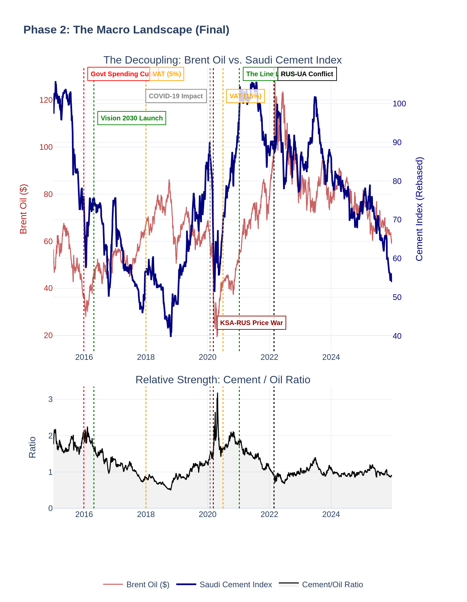
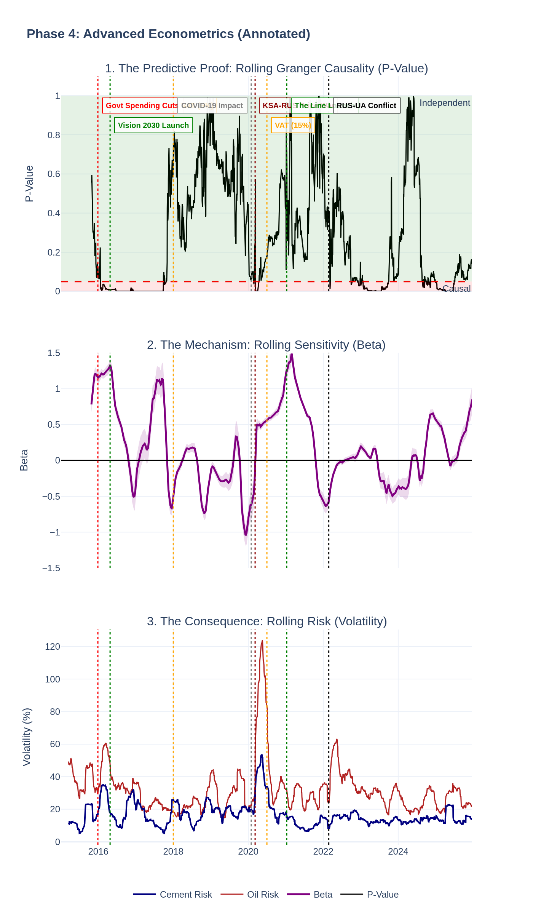
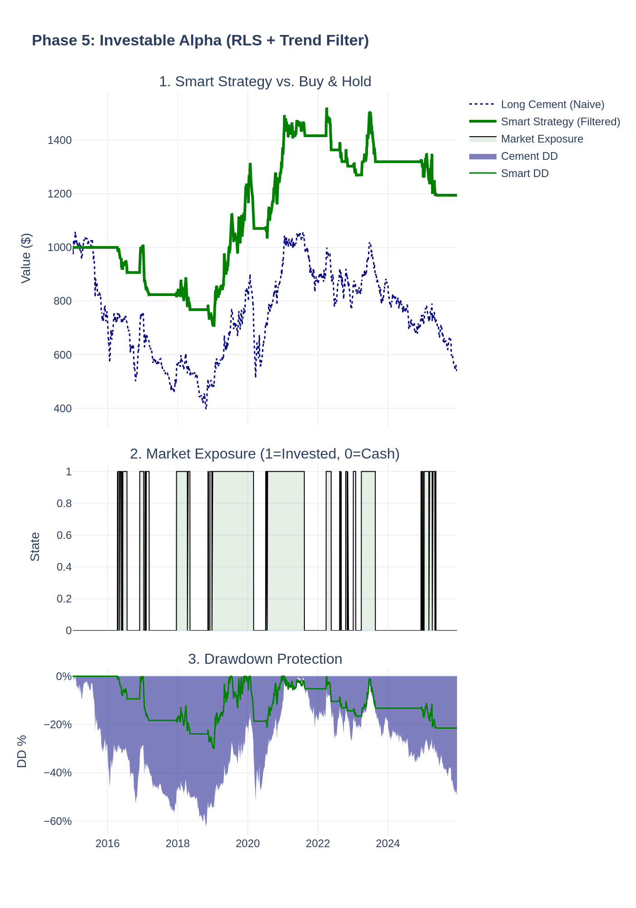

# 

# The Concrete Decoupling: Vision 2030 & The Saudi Construction Sector

### Project Overview
For decades, the Saudi construction sector was a mirror of oil prices. This project uses econometric analysis (Granger Causality, Rolling Beta, etc.) to prove that **Vision 2030 has successfully broken this link**, transforming the sector from a high-beta oil proxy into a defensive safe haven.

We then built an **Institutional Trading Engine** (Recursive Least Squares) to test if this decoupling could be traded.
* **Naive Strategy:** -62.5% Drawdown (Loss)
* **Smart Strategy:** -30.2% Drawdown (Capital Preservation)

---

### Repository Structure
* `Concrete_Decoupling_Master_v2.ipynb`: The complete Python analysis
* `visuals/`: All generated charts, dashboards, and heatmaps
* `data/`: Processed financial data (2015-2025)

### [View the Master Dashboard (HTML)](visuals/MASTER_DASHBOARD.html)
* Images in the dashboard are not interactive.
* Visuals folder contains interactive and png versions of each visual.

---

### Key Results

**1. Econometric Verification (The Decoupling)**
* **Risk Shift:** Cement volatility is now ~50% lower than oil volatility, confirming safe haven status.
* **Broken Chain:** Rolling Granger Causality tests confirm the predictive link was severed in 2021.
* **No Lag:** Tests at 1, 3, 6 and 12-month delays show statistically insignificant correlation.

**2. Trading Performance (2015-2025)**
The 'Smart' algorithm (Trend Filter + RLS Hedge) successfully prevented capital destruction during the sector's bear market.

| Metric | Naive Holding | Smart Strategy | Improvement |
| :--- | :--- | :--- | :--- |
| **Annual Return (CAGR)** | -4.5% | +1.3% | Turned Loss to Profit |
| **Max Drawdown** | -62.5% | -30.2% | Crash Risk Halved |
| **Volatility** | 17.9% | 10.1% | Smoother Ride |
| **Sharpe Ratio** | -0.25 | +0.13 | Efficiency Gain |

**Final Verdict:** The petro-link is broken. The sector is no longer a dangerous derivative of oil and has matured into a domestic defensive asset.

---

### Methodology
The project is divided into 6 phases:
1.  **Basket Creation:** Constructing a custom EW-Index of the Big 4 cement companies.
2.  **Macro Trends:** Visualising the decoupling phenomenon.
3.  **Lag Analysis:** Disproving the theory that construction merely lags oil.
4.  **Econometrics:** Rolling Granger Causality & Beta testing.
5.  **Alpha Strategy:** Building a Trend-Filtered RLS trading algorithm.
6.  **Non-statistical Summary**
